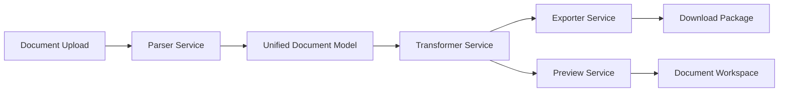

# DocForge AI

DocForge AI is a polished private-demo product for turning PDFs, reports, and manuals into AI-ready content packages. The goal is fastest first payday: sell done-for-you document conversion before adding full SaaS infrastructure.

The current build supports single conversion, batch conversion, goal-based deliverables, Markdown/HTML/JSON/plain text outputs, extracted images, complete ZIP packages, processing reports, and lead capture.

Do not add Supabase, Stripe, auth, Redis, cloud storage, Docker, complex admin panels, or team accounts yet.

## Correct Local Path

Use this repo path:

```bash
cd /Users/caleb/Documents/docforge-ai
```

Avoid the older shorthand path `/Users/caleb/docforge-ai`; commands and storage paths in this project assume the `Documents/docforge-ai` location.

## Runtime Notes

- Frontend: Next.js 16.2.10.
- Recommended Node: current active Node 20+ or 22+.
- Backend: FastAPI with `marker_single` available in the active Python environment.
- Frontend port: `3000`.
- Backend port: `8000`.

If the Next dev server does not bind to port 3000:

```bash
cd /Users/caleb/Documents/docforge-ai/frontend
npm run dev -- -p 3000
```

If the command starts but never prints a local URL and `lsof -nP -iTCP:3000 -sTCP:LISTEN` shows nothing, use the production demo fallback:

```bash
npm run build
npm run start -- -p 3000
```

If the port is already used, stop the old process or temporarily run:

```bash
npm run dev -- -p 3001
```

Then set the frontend API URL only if needed:

```bash
NEXT_PUBLIC_API_BASE_URL=http://localhost:8000 npm run dev -- -p 3001
```

## Start The Demo

Backend:

```bash
cd /Users/caleb/Documents/docforge-ai
source .venv/bin/activate
pip install -r backend/requirements.txt
uvicorn backend.main:app --reload --host 0.0.0.0 --port 8000
```

Frontend:

```bash
cd /Users/caleb/Documents/docforge-ai/frontend
npm install
npm run dev -- -p 3000
```

Open:

```text
http://localhost:3000
```

## Demo Checklist

1. Start backend on port 8000.
2. Start frontend on port 3000.
3. Open the document workspace.
4. Choose a goal such as `AI Knowledge Base` or `RAG Dataset`.
5. Test single conversion with a PDF.
6. Open each output tab: Markdown, Rendered Preview, Clean HTML, Structured JSON, Plain Text, Images, Processing Report.
7. Click `Download Complete Package`.
8. Test batch conversion with two PDFs if sample files are available.
9. Confirm the ZIP includes a batch processing report.
10. Submit the bulk conversion form.
11. Inspect saved leads:

```bash
tail -n 5 /Users/caleb/Documents/docforge-ai/storage/leads/leads.jsonl
```

## What The Complete Package Includes

Single conversion package:

```text
document.md
document.html
document.json
document.txt
processing-report.md
selected-goal-output.md
images/
```

Batch package:

```text
markdown/
html/
json/
text/
goal-output/
reports/
batch-processing-report.md
_summary.json
```

## Goal-Based Deliverables

The document workspace asks what the customer wants to create:

- AI Knowledge Base
- RAG Dataset
- Study Guide
- Technical Documentation
- Blog Draft
- Meeting Notes
- Training Manual
- Clean Markdown Export

These are rule-based transformations for now. No LLM APIs are called.

## Architecture



Request flow:

```text
FastAPI route
  -> service orchestration
  -> parser
  -> transformer
  -> exporter
  -> preview response
```

## Folder Structure

```text
backend/
  main.py
  services/
    parser.py
    transformer.py
    exporter.py
    preview.py
    models.py
frontend/
  app/
    page.tsx
    globals.css
storage/
  uploads/
  output/
  zips/
  leads/
```

## Unified Document Model

Each processed PDF becomes one internal `Document` object:

```text
Document
  metadata
  pages
  sections
  headings
  paragraphs
  tables
  images
  lists
  code_blocks
  footnotes
```

Exports, reports, previews, and image handling consume this model instead of passing raw Markdown across the app.

## Adding New Goals

Goal transformations live in `backend/services/transformer.py`.

To add a goal:

1. Add a `TemplateKey` value in `backend/services/models.py`.
2. Add a label in `TEMPLATE_LABELS`.
3. Create a function that accepts `Document` and returns Markdown.
4. Register it in `TEMPLATE_TRANSFORMERS`.
5. Add a goal card in `frontend/app/page.tsx`.

## Adding New Exporters

Export writing lives in `backend/services/exporter.py`.

To add a format:

1. Extend `OutputFormat` in `backend/services/models.py`.
2. Add file extension and content handling in `backend/services/exporter.py`.
3. Add the corresponding customer-facing output tab in `frontend/app/page.tsx`.

## Fastest First Payday Plan

Sell the manual service first. Use the demo to show the customer one representative PDF, then quote a package to process the rest.

### What To Sell First

- Clean AI-ready Markdown for one messy PDF.
- Report/manual conversion package with Markdown, JSON, HTML, text, and a processing report.
- Bulk conversion package for a folder of PDFs, manuals, reports, or course materials.
- Add-on: organize the results into a knowledge base or RAG-ready dataset.

### Who To Contact First

- Consultants with client reports and deliverables.
- AI builders making assistants or retrieval demos.
- Researchers with papers and PDFs.
- Students with lecture PDFs or study materials.
- Small teams with manuals, SOPs, policies, or onboarding docs.
- Agencies handling document-heavy client projects.

### How To Demo It

1. Ask for one representative PDF.
2. Choose the most relevant goal card.
3. Process the document live.
4. Show the metadata summary and pipeline status.
5. Click through the output tabs.
6. Download the complete package.
7. Open the ZIP and show the named files.
8. Offer to process the remaining files manually.

### What To Charge Manually

- `$25` small document cleanup.
- `$75-$150` report or manual conversion package.
- `$250+` bulk conversion package.

Raise prices for urgent turnaround, many files, scanned PDFs, or manual cleanup.

## Current Limitations

- Private-demo/local operator workflow.
- Marker runs synchronously inside each request.
- Batch conversion processes files one by one.
- Page count is estimated without adding a PDF parsing dependency.
- Rule-based goals are intentionally simple.
- No auth, billing, database, hosted storage, background worker, or admin dashboard.
- Large or complex PDFs may take several minutes.
- Output quality depends on Marker and source PDF quality.

## Next Build

The next build should focus on final demo polish only:

- Add a small `/demo-samples` folder with safe test PDFs.
- Add a local smoke-test script for conversion and ZIP inspection.
- Add a lightweight lead review page if manual follow-up becomes painful.

Do not add full SaaS infrastructure until a customer has paid or clearly committed.
