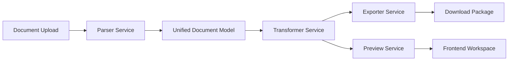

# DocForge AI

DocForge AI is a document processing platform that turns PDFs into AI-ready content packages. It keeps the existing single and batch PDF conversion flows, then adds a reusable transformation pipeline, structured document model, multiple exports, extracted image handling, metadata summaries, and processing reports.

No auth, billing, database, queue, Docker, cloud storage, or hosted deployment is required for the current local/private-demo version.

## Architecture



Request flow:

```text
FastAPI route
  -> service orchestration
  -> parser
  -> transformer
  -> exporter
  -> preview response
```

## Folder Structure

```text
backend/
  main.py
  services/
    parser.py        # PDF validation, Marker execution, normalized document creation
    transformer.py   # Template rules, HTML/text/JSON transformation helpers
    exporter.py      # Markdown, HTML, JSON, text, report, image, and package downloads
    preview.py       # Frontend-ready metadata, pipeline, image, and report payloads
    models.py        # Internal document and export dataclasses
frontend/
  app/
    page.tsx         # Document workspace, templates, previews, downloads, lead capture
    globals.css      # Lightweight SaaS UI styling
storage/
  uploads/
  output/
  zips/
  leads/
```

## Unified Document Model

The backend now normalizes each processed PDF into one internal `Document` object:

```text
Document
  metadata
    job_id
    filename
    source_path
    page_count
    conversion_time_seconds
    output_size_bytes
    created_at
  pages
  sections
  headings
  paragraphs
  tables
  images
  lists
  code_blocks
  footnotes
```

Downstream exports, metadata, image listings, reports, and frontend previews consume this model instead of passing raw Markdown through the app.

## Transformation Pipeline

Current pipeline:

```text
Upload -> Parse -> Transform -> Export -> Complete
```

Current transformation templates are rule-based and do not call any LLM APIs:

- General Markdown
- RAG Dataset
- Study Notes
- Meeting Notes
- Knowledge Base
- Technical Documentation
- Blog Draft
- API Documentation

The template contract lives in `backend/services/transformer.py`. Add a template by:

1. Adding the key to `TemplateKey` in `backend/services/models.py`.
2. Adding a label to `TEMPLATE_LABELS`.
3. Creating a transformer function that accepts `Document` and returns Markdown.
4. Registering it in `TEMPLATE_TRANSFORMERS`.
5. Adding the option to the frontend `templates` array.

## Output Formats

Single conversion now generates:

- Markdown
- Clean HTML
- Structured JSON
- Plain text
- Processing report
- Extracted images ZIP when images exist
- Full download package ZIP

Batch conversion now packages generated Markdown, JSON, HTML, text, and processing reports for each successful file.

Add a future exporter by:

1. Extending `OutputFormat` in `backend/services/models.py`.
2. Adding an extension and content writer in `backend/services/exporter.py`.
3. Adding a download option in `frontend/app/page.tsx`.

## Local Setup

Create or activate the Python environment where Marker is installed:

```bash
cd /Users/caleb/Documents/docforge-ai
source .venv/bin/activate
```

If your Marker virtual environment lives somewhere else, activate that environment instead. The backend requires `marker_single` to be available in the active shell.

Install backend requirements and start FastAPI:

```bash
pip install -r backend/requirements.txt
uvicorn backend.main:app --reload --host 0.0.0.0 --port 8000
```

Start the frontend in a second terminal:

```bash
cd /Users/caleb/Documents/docforge-ai/frontend
npm install
npm run dev
```

Open `http://localhost:3000`.

## API

Single conversion:

```bash
curl -F "file=@sample.pdf" \
  "http://localhost:8000/convert?template=general_markdown"
```

Batch conversion:

```bash
curl -o docforge-batch.zip \
  -F "files=@sample-a.pdf" \
  -F "files=@sample-b.pdf" \
  http://localhost:8000/convert-batch
```

Lead capture:

```bash
curl -X POST http://localhost:8000/lead \
  -H "Content-Type: application/json" \
  -d '{
    "name": "Ada Lovelace",
    "email": "ada@example.com",
    "company": "Example Co",
    "document_count": "25",
    "document_type": "Technical manuals",
    "message": "We need clean content for an AI knowledge base."
  }'
```

Downloads are exposed by job ID:

```text
/download/{job_id}/markdown
/download/{job_id}/html
/download/{job_id}/json
/download/{job_id}/text
/download/{job_id}/report
/download/{job_id}/images.zip
/download/{job_id}/package
/download/{job_id}/images/{filename}
```

## Future API Hooks

The service boundaries are ready for future integrations without rewriting route handlers:

- OpenAI
- Claude
- Gemini
- Local LLMs
- OCR enhancements
- Embeddings
- Vector databases

Recommended future shape:

```text
services/
  ai/
    provider.py
    openai_provider.py
    claude_provider.py
    gemini_provider.py
  ocr.py
  embeddings.py
  vector_store.py
```

## Current Limitations

- Local/private-demo only.
- Marker runs synchronously inside each request.
- Batch conversion processes files one by one.
- Page count is estimated without adding a PDF parsing dependency.
- Rule-based templates are intentionally simple.
- No auth, billing, database, hosted storage, background worker, or admin dashboard.
- Large or complex PDFs may take several minutes.
- Output quality depends on Marker and source PDF quality.

## Roadmap

- Background jobs for long conversions.
- Persisted job history and document package browsing.
- Admin lead review screen.
- Template versioning and custom templates.
- LLM-assisted enrichment behind the transformer interface.
- OCR improvements for scanned PDFs.
- Embeddings and vector database exports.
- Hosted storage and secure customer delivery.
- Billing after repeat demand is proven.

